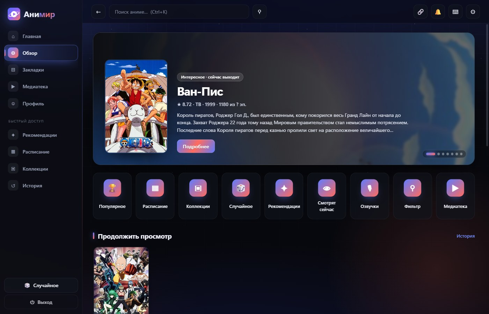
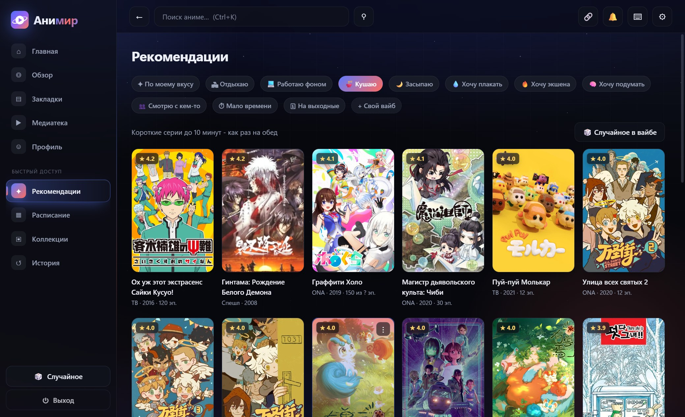
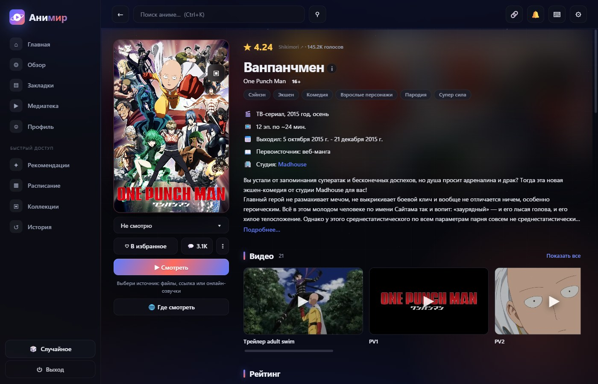
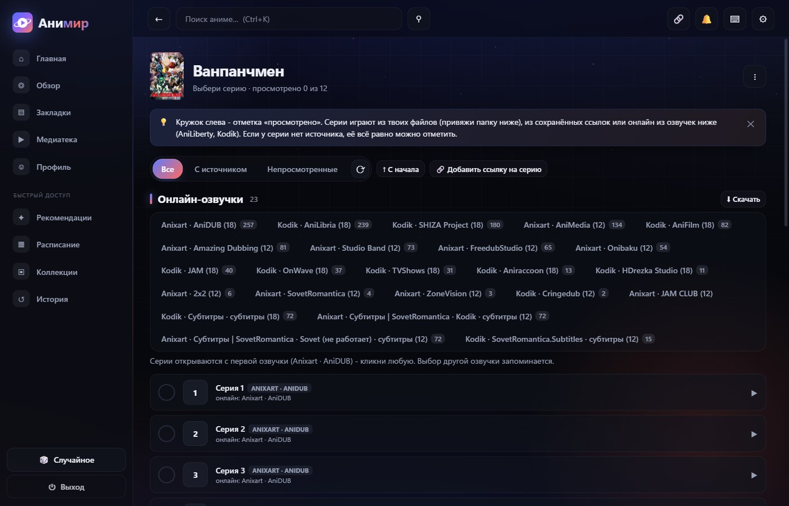
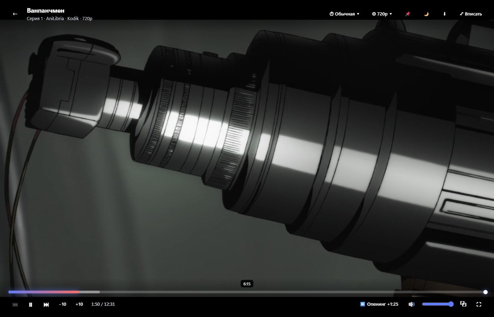
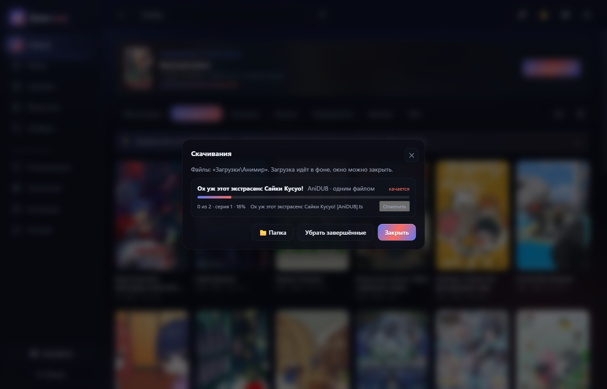
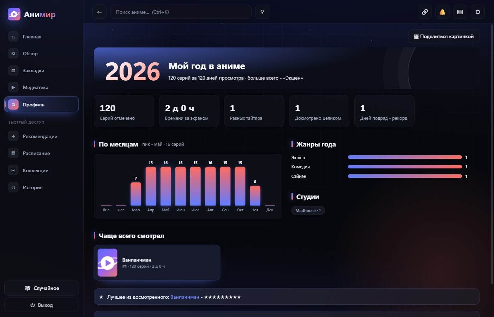

<h1 align="center">Анимир</h1>

<b>Аниме на компьютере без браузера и лишнего шума.</b> 
Каталог Shikimori, онлайн-озвучки, свой плеер и скачивание серий. Всё в одном окне.

  
  
  

## Почему в него залипают

| | |
|---|---|
| 🎬 **Всё в одном окне** | Каталог, озвучки, плеер и закладки. Никаких вкладок, расширений и всплывающей рекламы. |
| ⬇ **Скачивание серий** | Одна серия, диапазон или вся озвучка целиком. Прогресс, отмена, файлы в «Загрузки\Анимир». |
| 🎧 **Озвучки по популярности** | Anixart, AniLiberty и Kodik в одном списке: сначала те, кого смотрят чаще. |
| 🖥 **До 4K** | Свои файлы играет в родном разрешении, онлайн-озвучки - до 1080p. Качество само подстраивается: старт с 720p и подъём выше, если успевает качать. |
| 🌙 **Ночной кинозал** | Тихие цвета, крупные субтитры, звук до 60 % и вопрос «ещё одну или спать?» после N серий. |
| 🔋 **Экономия батареи** | В простое 1,2 % ядра, на батарее ещё меньше. Ноутбук не греется и не орёт вентиляторами. |
| ✨ **Вайбы** | «Кушаю», «Работаю фоном», «Хочу плакать», свои наборы жанров и случайный тайтл под настроение. |
| 🔔 **Уведомления с постером** | Новая серия, премьера или ответ на комментарий - прямо в Windows. |
| 🏆 **Достижения и «Мой год»** | Значки за просмотренное и итоги года картинкой, которой можно похвастаться. |

## Скачать

[**Установщик или портативный exe →**](../../releases/latest)

- Установка в один шаг: папку выбирать не нужно, права администратора не нужны.
- Портативная версия запускается сразу, без установки.
- Windows может спросить про неизвестного издателя (файл без подписи): «Подробнее» → «Выполнить всё равно».

**Нужны:** Windows 10 или 11, 64 бита, WebView2 (в системе уже есть).

## Первые минуты

1. Войди через Shikimori в «Профиле», чтобы подтянулись списки и оценки. Можно и без этого.
2. Найди тайтл, открой серии и выбери озвучку: выбор запомнится.
3. Смотри сразу или нажми ⬇, чтобы скачать серию.

Клавиши: `Пробел` пауза, `F` полный экран, `S` пропустить опенинг, `Shift+N` следующая. Полный список - `?` в приложении.

## Скриншоты

| Рекомендации по вайбу | Страница тайтла | Серии и озвучки |
|---|---|---|
|  |  |  |

| Плеер | Скачивания | «Мой год в аниме» |
|---|---|---|
|  |  |  |

---

Проект развивается вместе с **OverLord228** ([Animax](https://github.com/0verLorD228/Animax)) - именно с него начинался Анимир.

Анимир - неофициальный клиент для личного использования. Не связан с Shikimori, Anixart, AniLiberty и Kodik;
права на каталог, видео и обложки принадлежат их владельцам. Код - [MIT](LICENSE).
