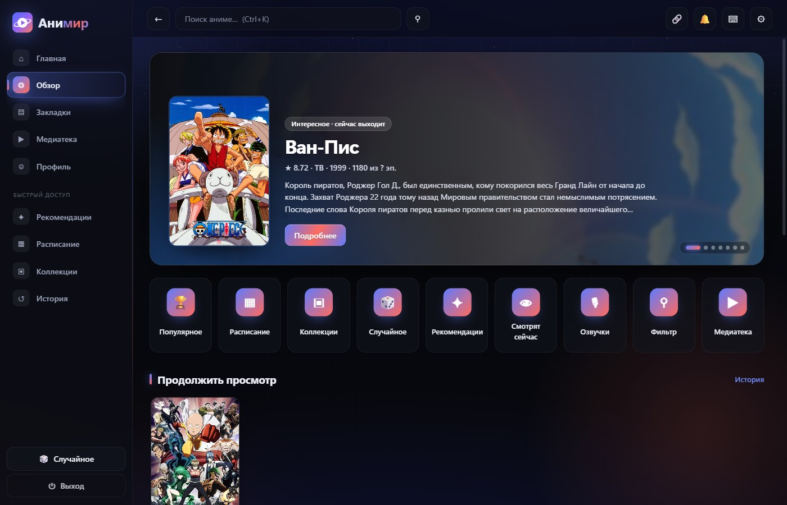
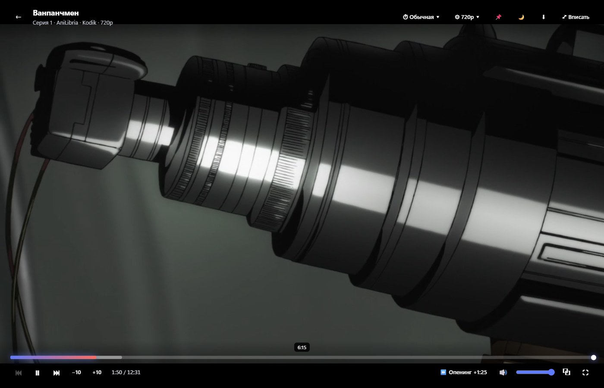

# Анимир

Настольный клиент для Windows с каталогом Shikimori, встроенным видеоплеером, выбором озвучек и загрузкой серий.

[Скачать для Windows](https://github.com/Grom1143/Animir/releases/latest) · [История изменений](CHANGELOG.md)



## Возможности

- Поиск по каталогу, закладки и синхронизация прогресса с профилем Shikimori.
- Выбор озвучки и качества, полноэкранный режим, ночной режим и масштабирование изображения.
- Загрузка отдельной серии или диапазона серий с индикатором прогресса.
- Офлайн-кэш каталога и режим экономии батареи.

## Запуск

В релизах доступны установщик и портативная сборка для Windows 10 и 11 x64. Приложению нужен Microsoft Edge WebView2 Runtime.

Для запуска из исходников установите Python 3.10 или новее и выполните из каталога репозитория:

```powershell
python -m pip install -e .
python Animir.pyw
```

Инструкции для сборки установщика и портативной версии находятся в [packaging](packaging/README.md).

## Скриншоты

| Каталог и рекомендации | Плеер | Загрузки |
| --- | --- | --- |
|  |  |  |

## Авторы и лицензия

Анимир развивается вместе с **OverLord228**. В основе проекта [Animax](https://github.com/0verLorD228/Animax). Код распространяется по [лицензии MIT](LICENSE).

Анимир — неофициальный клиент. Права на каталог, видео и обложки принадлежат их правообладателям.
